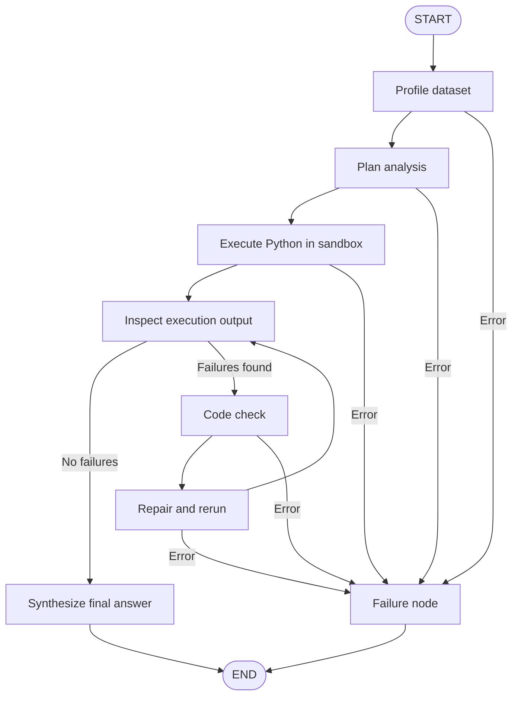
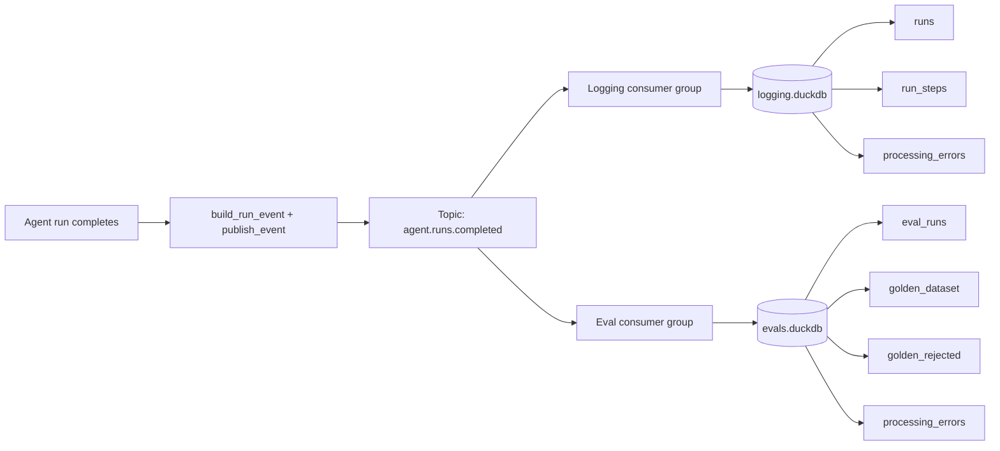

# Data Analytics Agentic AI

**Ask questions of a CSV file. Get answers, tables, and charts — not just chat text.**

A multi-agent data analytics system that profiles a dataset, plans the analysis, writes and executes Python in a sandbox, repairs its own failures, and returns a grounded answer with visualizations.

---

## Table of Contents

- [The Problem](#the-problem)
- [The Solution](#the-solution)
- [How It Works](#how-it-works)
- [Features](#features)
- [Tech Stack](#tech-stack)
- [Quickstart](#quickstart)
- [Configuration](#configuration)
- [Usage](#usage)
- [Kafka Event Bus and Observability](#kafka-event-bus-and-observability)
- [Evaluation and Golden Dataset](#evaluation-and-golden-dataset)
- [Project Structure](#project-structure)
- [Data and Output Artifacts](#data-and-output-artifacts)
- [Safety and Guardrails](#safety-and-guardrails)
- [Testing](#testing)
- [Troubleshooting](#troubleshooting)
- [Limitations](#limitations)
- [Roadmap](#roadmap)
- [Contributing](#contributing)
- [License](#license)
- [Acknowledgements](#acknowledgements)

---

## The Problem

Data analysts spend hours doing work that should take minutes:

- Opening CSV files and manually inspecting columns, dtypes, missing values, and date formats.
- Writing repetitive pandas code for filtering, grouping, aggregation, and joins.
- Debugging failed scripts, especially around date parsing, comma-formatted numbers, and incorrect grouping keys.
- Creating charts one by one and formatting them for presentation.
- Double-checking whether the numbers actually answer the original question.

A simple business question such as *"Which region has the highest sales, and what are the top five sub-categories by profit?"* can turn into a long cycle of exploration, code, errors, and manual chart creation.

General-purpose chat assistants do not solve this well. They can describe what an analyst should do, but they usually cannot safely execute code, inspect the actual dataset, catch their own mistakes, or return real charts.

---

## The Solution

This project turns a CSV and a natural-language question into an executed analysis.

Given:

- a CSV dataset, and
- a user question,

the agent:

1. **Profiles the dataset** inside a sandbox.
2. **Creates an analysis plan** based only on columns that actually exist.
3. **Writes and executes Python** using pandas, matplotlib, and seaborn.
4. **Captures stdout, errors, and PNG charts.**
5. **Inspects failures** and runs a code-check and repair loop when needed.
6. **Synthesizes a final answer** using only values and artifacts from execution.
7. **Publishes a run event** to Kafka for logging and evaluation.

It is not a text-only assistant. It performs the analysis.

Example questions it is designed to handle:

- *"What is the total sales?"*
- *"Create a bar chart of total sales by region and a line chart of monthly sales over time."*
- *"Which region has the highest sales, and what are the top five sub-categories by profit?"*
- *"Compare profit trends across categories and highlight the weakest segment."*
- *"Find the month with the highest sales and explain the trend."*

---

## How It Works

The core workflow is a LangGraph state machine:



### Agent roles

| Stage | Role | What it does |
|---|---|---|
| `profile` | Dataset Profiler | Uploads the CSV to an E2B sandbox and collects shape, columns, dtypes, missing values, duplicates, head, tail, and per-column statistics. |
| `plan` | Planning Agent | Converts the user request and dataset profile into ordered analysis steps. It cannot execute code. |
| `exec` | Exec Agent | Validates the plan, writes Python, and runs it with the `run_python` tool inside E2B. Captures stdout, stderr, tracebacks, and PNG images. |
| `inspect` | Failure Inspector | Scans execution output for errors and decides whether repair is needed. |
| `code_check` | Code Check Agent | Reviews failed code for logic, syntax, and tech-stack violations, then proposes corrected code with reasoning. |
| `repair` | Repair Agent | Applies the checker fixes in a fresh sandbox and reruns the failed work. |
| `synthesis` | Synthesis Agent | Produces the final answer using only values and tables present in the execution output. |
| `failure` | Failure Handler | Records the terminal error and preserves the run for evaluation. |

### What the system returns

A completed run can include:

- A natural-language answer.
- Structured tables and computed values.
- One or more PNG charts.
- Full execution logs.
- A step-by-step LangGraph state trace.
- Kafka events for logging and evaluation.

---

## Features

### Analysis and execution

- Natural-language querying over CSV files.
- Automatic dataset profiling before planning.
- Plan validation before code generation.
- Sandboxed Python execution with E2B.
- Pandas, NumPy, matplotlib, and seaborn support.
- PNG chart capture from matplotlib.
- Support for multiple scripts in one run.

### Reliability and self-repair

- Execution inspection after every run.
- Static code checks for syntax and unsafe operations.
- LLM-based code review with line-level fixes.
- Fresh-sandbox repair runs.
- Configurable repair attempts.
- Explicit failure state and error history.

### Observability

- Kafka event published when a run completes.
- Logging consumer stores every run in DuckDB.
- Step-level LangGraph state snapshots stored in `run_steps`.
- Evaluation consumer writes every run to `eval_runs`.
- Dead-letter tables for failed message processing.
- At-least-once processing with idempotent DuckDB upserts.

### Evaluation

- Regex-based error detection.
- Human thumbs-up / thumbs-down feedback with optional written reasoning.
- LLM-as-a-judge evaluation using Groq.
- Bad-case gate with strong signals and evidence checks.
- Append-only golden dataset of accepted bad cases.
- Separate audit table for rejected runs.
- Infrastructure failures excluded from the golden dataset.

### Safety

- Sandboxed code execution.
- Import allowlist.
- Blocked shell, subprocess, network, and destructive filesystem operations.
- Static syntax and tech-stack validation.
- Secrets loaded from `.env` and excluded from git.
- Base64 images stripped from Kafka events.
- Event truncation to protect Kafka message size.

---

## Tech Stack

| Layer | Technology | Purpose |
|---|---|---|
| Language | Python 3.12 | Core implementation |
| Package manager | uv | Dependency management and locked environments |
| Orchestration | LangGraph | State machine and agent routing |
| Agent framework | LangChain | Prompts, tools, structured outputs |
| Plan / Exec / Check models | NVIDIA Nemotron via OpenAI-compatible API | Planning, code generation, code review |
| Synthesis model | Groq `openai/gpt-oss-120b` | Final answer generation |
| Judge model | Groq `openai/gpt-oss-120b` | Automated run evaluation |
| Sandbox | E2B Code Interpreter | Isolated Python execution |
| Data analysis | pandas, NumPy | Data manipulation and aggregation |
| Visualization | matplotlib, seaborn | Charts and PNG output |
| Event bus | Apache Kafka 3.9.1 (KRaft) | Run-completion events |
| Kafka client | `kafka-python` | Producer, consumers, and admin client |
| Local analytics store | DuckDB | Logging, evaluation, and golden dataset |
| Validation | Pydantic | Event and judge-output schemas |
| Configuration | python-dotenv | `.env` loading |
| CLI | argparse | Runnable commands and maintenance tasks |

---

## Quickstart

### Prerequisites

- Python 3.12+
- [uv](https://docs.astral.sh/uv/)
- Docker Desktop, only if you want Kafka logging and evaluation
- API keys:
  - `E2B_API_KEY`
  - `NVIDIA_API_KEY`
  - `GROQ_API_KEY`

### 1. Install dependencies

```bash
uv sync
```

### 2. Create a `.env` file

```dotenv
E2B_API_KEY=your_e2b_key
NVIDIA_API_KEY=your_nvidia_key
GROQ_API_KEY=your_groq_key
```

Optional values are documented in [Configuration](#configuration).

### 3. Run an analysis

```bash
uv run python main.py "What is the total sales?" --dataset "Data /SuperStoreOrders.csv"
```

A plot-heavy query:

```bash
uv run python main.py \
  "Create a bar chart of total sales by region and a line chart of monthly total sales over time. Also report the highest-sales region and the top 5 sub-categories by profit." \
  --dataset "Data /SuperStoreOrders.csv"
```

### 4. Run without Kafka

Kafka logging is optional:

```bash
KAFKA_ENABLED=false uv run python main.py "What is the total sales?"
```

### 5. Start local Kafka

```bash
docker compose -f "Kafka -Evant Bus/docker-compose.yml" up -d
```

If your machine only has the standalone Compose binary:

```bash
docker-compose -f "Kafka -Evant Bus/docker-compose.yml" up -d
```

Wait for the broker to become healthy:

```bash
docker inspect -f '{{.State.Health.Status}}' agentic-kafka
```

Expected:

```text
healthy
```

### 6. Initialize Kafka topics and DuckDB tables

```bash
uv run python "Kafka -Evant Bus/kafka-events.py" init-topics
uv run python "Kafka -Evant Bus/kafka-events.py" init-db
```

### 7. Run the consumers

Start each consumer in its own terminal:

```bash
uv run python "Kafka -Evant Bus/kafka-events.py" logging-consumer
uv run python "Kafka -Evant Bus/kafka-events.py" eval-consumer
```

For batch processing, drain the current backlog and exit:

```bash
uv run python "Kafka -Evant Bus/kafka-events.py" logging-consumer --once
uv run python "Kafka -Evant Bus/kafka-events.py" eval-consumer --once
```

To evaluate without calling the LLM judge:

```bash
uv run python "Kafka -Evant Bus/kafka-events.py" eval-consumer --once --no-judge
```

---

## Configuration

All configuration is read from environment variables. The project loads `.env` from the repository root.

### Required

| Variable | Description |
|---|---|
| `E2B_API_KEY` | E2B sandbox API key. Required for profiling and code execution. |
| `NVIDIA_API_KEY` | NVIDIA API key for planning, execution, and code-check models. |
| `GROQ_API_KEY` | Groq API key for synthesis and LLM-as-a-judge evaluation. |

### Optional model settings

| Variable | Default | Description |
|---|---|---|
| `NVIDIA_MODEL` | `nvidia/nemotron-3.5-super-vl-120b-a12b` | Exec Agent model. |
| `NVIDIA_BASE_URL` | `https://integrate.api.nvidia.com/v1` | NVIDIA OpenAI-compatible endpoint. |
| `GROQ_MODEL` | `openai/gpt-oss-120b` | Synthesis model. |
| `EVAL_JUDGE_MODEL` | `openai/gpt-oss-120b` | Kafka evaluation judge model. |
| `EVAL_JUDGE_MAX_CHARS` | `24000` | Maximum event JSON characters sent to the judge. |

### Kafka settings

| Variable | Default | Description |
|---|---|---|
| `KAFKA_ENABLED` | `true` | Master switch for Kafka publishing. |
| `KAFKA_BOOTSTRAP_SERVERS` | `localhost:9092` | Kafka broker address. |
| `KAFKA_RUN_TOPIC` | `agent.runs.completed` | Topic for completed run events. |
| `KAFKA_LOGGING_GROUP` | `agent-logging-v1` | Consumer group for logging. |
| `KAFKA_EVAL_GROUP` | `agent-evals-v1` | Consumer group for evaluation. |
| `KAFKA_MAX_EVENT_BYTES` | `900000` | Maximum serialized event size before truncation. |
| `KAFKA_MAX_PROCESS_ATTEMPTS` | `3` | Retry count before writing to the dead-letter table. |
| `KAFKA_DATA_DIR` | `Kafka -Evant Bus/data` | Runtime DuckDB directory. |

### DuckDB settings

| Variable | Default | Description |
|---|---|---|
| `LOGGING_DUCKDB_PATH` | `Kafka -Evant Bus/data/logging.duckdb` | Run logging database. |
| `EVAL_DUCKDB_PATH` | `Kafka -Evant Bus/data/evals.duckdb` | Evaluation and golden dataset database. |

### Observability settings

| Variable | Description |
|---|---|
| `LANGCHAIN_TRACING_V2` | Enable LangSmith tracing. |
| `LANGCHAIN_PROJECT` | LangSmith project name. |
| `LANGSMITH_API_KEY` | LangSmith API key. |
| `LOG_LEVEL` | Python log level. Defaults to `INFO`. |

---

## Usage

### Basic question

```bash
uv run python main.py "What is the total sales?"
```

### Custom dataset

```bash
uv run python main.py \
  "Which category has the highest profit margin?" \
  --dataset "/path/to/your.csv"
```

### Plot and multi-step analysis

```bash
uv run python main.py \
  "Create two charts from the dataset: a bar chart of total sales by region, and a line chart of monthly total sales. Also report the top 5 sub-categories by profit."
```

### Custom job ID

```bash
uv run python main.py "What is the total sales?" --job-id my-analysis-001
```

### Increase repair attempts

```bash
uv run python main.py "Analyze monthly profit trends" --max-repair-attempts 3
```

### JSON output

```bash
uv run python main.py "What is the total sales?" --json
```

The JSON output is useful for debugging. It can be large because it includes execution logs and image data.

### Human feedback

```bash
uv run python "Kafka -Evant Bus/kafka-events.py" feedback \
  --run-id my-analysis-001 \
  --rating down \
  --text "The analysis grouped by month number instead of year-month."
```

Human feedback can promote a previously rejected run into the golden dataset if it passes the bad-case gate.

### Replay a saved event

```bash
uv run python "Kafka -Evant Bus/kafka-events.py" replay \
  --event-file event.json \
  --consumer logging
```

```bash
uv run python "Kafka -Evant Bus/kafka-events.py" replay \
  --event-file event.json \
  --consumer evals \
  --no-judge
```

Replay bypasses Kafka and writes directly into DuckDB.

---

## Kafka Event Bus and Observability

Kafka is used to decouple the agent from logging and evaluation.

### Event flow



### Producer

The producer runs at the end of `main.run_workflow()`.

It sends the event with:

- key: `run_id`
- value: JSON event
- headers: `event_type`, `schema_version`

Using `run_id` as the key preserves per-run ordering within a Kafka partition.

Kafka publishing is non-fatal. If the broker is unavailable, the agent still returns its analysis and logs a warning.

### Topic

Default topic:

```text
agent.runs.completed
```

Local setup:

- 3 partitions
- replication factor 1
- gzip compression
- `acks=all`

### Consumers

| Consumer group | Writes to | Purpose |
|---|---|---|
| `agent-logging-v1` | `logging.duckdb` | Stores every run and every LangGraph step. |
| `agent-evals-v1` | `evals.duckdb` | Evaluates runs and builds the golden bad-case dataset. |

Both groups receive every event because they use different group IDs.

### Reliability

- Manual offset commits.
- At-least-once processing.
- Retry by seeking back to the failed message offset.
- Dead-letter tables after repeated failures.
- Idempotent writes using `run_id` upserts.

### Logging tables

| Table | Contents |
|---|---|
| `runs` | One row per agent run, including query, status, plan, execution, synthesis, timings, and image count. |
| `run_steps` | One row per LangGraph state snapshot, including stage, status, error, and full sanitized state JSON. |
| `processing_errors` | Dead-letter records for messages that could not be processed. |

### Evaluation tables

| Table | Contents |
|---|---|
| `eval_runs` | One row per evaluated run, including regex signals, judge output, human feedback, gate checks, and golden status. |
| `golden_dataset` | Accepted bad cases only. Append-only and unique by `run_id`. |
| `golden_rejected` | Audit trail for rejected runs, including missing gate requirements. |
| `processing_errors` | Dead-letter records for evaluation failures. |

### Inspecting the databases

```bash
uv run python - <<'PY'
import duckdb

logging = duckdb.connect("Kafka -Evant Bus/data/logging.duckdb", read_only=True)
evals = duckdb.connect("Kafka -Evant Bus/data/evals.duckdb", read_only=True)

print(logging.execute("SELECT run_id, final_status, stage FROM runs").fetchall())
print(logging.execute(
    "SELECT run_id, step_index, stage, status FROM run_steps ORDER BY run_id, step_index"
).fetchall())
print(evals.execute(
    "SELECT run_id, golden_status, failure_stage FROM eval_runs"
).fetchall())
print(evals.execute("SELECT run_id FROM golden_dataset").fetchall())

logging.close()
evals.close()
PY
```

---

## Evaluation and Golden Dataset

The evaluation consumer is responsible for deciding whether a run should become a bad-case example for future improvement.

### Signals

A run can be flagged through:

- Human thumbs-down with written reasoning.
- Agent failure.
- LLM judge failure.
- Regex-detected final execution error.
- Repair exhaustion.
- Any repair attempt, even if the final answer succeeded.
- Code-check activity.

### Gate requirements

A run enters `golden_dataset` only when all checks pass:

| Check | Meaning |
|---|---|
| `schema_valid` | Event matches the expected envelope. |
| `has_strong_signal` | At least one strong bad-case signal exists. |
| `complete_evidence` | Query, plan or attempts, outcome, stage, and reason are present. |
| `actionable_diagnosis` | There is something concrete to learn from. |
| `failure_origin_allowed` | Failure is attributed to agent behavior or human feedback. |
| `not_infra_failure` | Kafka, DuckDB, API-key, rate-limit, and sandbox-provisioning failures are excluded. |

### Human feedback rules

- A thumbs-down alone is not enough.
- A thumbs-down with written reasoning is a strong signal.
- A thumbs-down without text can still qualify if another strong signal exists.
- Human feedback can arrive after evaluation and trigger a gate refresh.
- Accepted golden rows are never modified by later feedback.

### Judge

The LLM judge receives:

- user query
- plan
- execution attempts, including repairs
- code-check history
- final synthesis

It returns:

- `PASS` or `FAIL`
- score from 1 to 5
- bottlenecks
- citations

Judge errors alone do not make a run a bad case. A strong agent signal is still required.

---

## Project Structure

```text
.
├── main.py                          # LangGraph workflow, CLI, Kafka producer hook
├── Agentic Loop /
│   ├── plan-agent.py                # Dataset profiling and planning agent
│   ├── exec-agent.py                # E2B execution agent and validation
│   ├── code-check-agent.py          # Static checks, code review, and repair output
│   └── plan.md                      # Agent design notes
├── Kafka -Evant Bus/
│   ├── kafka-events.py              # Producer, consumers, DuckDB stores, gate, CLI
│   ├── docker-compose.yml           # Local Kafka KRaft stack
│   └── kafka-architecture.md        # Original event-bus design notes
├── Evals/
│   └── eval-v1.py                   # Offline evaluation harness
├── Data-Analytics/
│   ├── main.ipynb                   # Exploration notebook
│   ├── eval_dataset.txt             # Evaluation cases
│   └── superstore_orders_summary.md # Dataset notes
├── Data /
│   └── SuperStoreOrders.csv         # Bundled sample dataset
├── E2E Output/                      # Generated charts from local runs
├── src/
│   └── data_analytics_agentic_ai_project/
├── pyproject.toml
├── uv.lock
├── .env                             # Local secrets, not committed
├── .gitignore
└── README.md
```

### Notes

- The directory name `Kafka -Evant Bus` is preserved as-is and must be quoted in shell commands.
- `E2E Output/` contains generated artifacts, not source code.
- Generated DuckDB files are ignored by git.

---

## Data and Output Artifacts

### Default dataset

The bundled sample is:

```text
Data /SuperStoreOrders.csv
```

The agent can be pointed at any CSV path with `--dataset`.

### Charts and images

Charts are captured by the E2B sandbox as PNG data and returned in the run state.

The Kafka event does not carry base64 image bytes. It stores only:

```text
image_count
```

To save charts locally, use the returned run state or an external wrapper around `main.run_workflow()`.

Generated example charts from a local run are available in:

```text
E2E Output/e2e-charts-20261106/
```

### DuckDB files

Runtime databases are created under:

```text
Kafka -Evant Bus/data/
├── logging.duckdb
└── evals.duckdb
```

These are excluded from git.

---

## Safety and Guardrails

### Execution isolation

All generated Python runs inside an E2B sandbox, not on the host machine.

### Static code checks

The code-check agent validates:

- syntax
- indentation
- defined imports
- allowed libraries
- blocked shell and network operations

### Import allowlist

Allowed libraries include:

- pandas
- numpy
- matplotlib
- seaborn
- standard-library helpers such as `json`, `math`, `re`, `datetime`, and `collections`

### Blocked operations

The system blocks patterns such as:

- `os.system` / `os.popen`
- `subprocess`
- shell escapes and IPython shell magics
- `shell=True`
- `curl` / `wget`
- `rm -rf`
- `sudo`
- `shutil.rmtree`
- network libraries such as `requests`, `httpx`, `urllib`, and `socket`

### Secret handling

- API keys are loaded from `.env`.
- `.env` is gitignored.
- Do not print or commit secrets.
- Kafka events contain execution data, not API keys.

### Message-size protection

- Events are capped at 900 KB by default.
- Large logs are progressively truncated.
- Base64 images are stripped.
- `event_truncated` marks events that lost detail.

---

## Testing

### Built-in self-test

```bash
uv run python "Kafka -Evant Bus/kafka-events.py" self-test
```

Expected output:

```text
self-test passed: 6 logs, 6 evals, 3 initial golden, 4 after promotion
```

The self-test verifies:

- event construction
- image stripping
- logging writes
- evaluation writes
- bad-case gate behavior
- infrastructure exclusion
- human-feedback promotion
- duplicate-safe upserts

### Syntax check

```bash
uv run python -m py_compile main.py "Kafka -Evant Bus/kafka-events.py"
```

### Whitespace check

```bash
git diff --check
```

### Kafka smoke test

```bash
docker inspect -f '{{.State.Health.Status}}' agentic-kafka
uv run python "Kafka -Evant Bus/kafka-events.py" init-topics
uv run python "Kafka -Evant Bus/kafka-events.py" logging-consumer --once
```

---

## Troubleshooting

### `GROQ_API_KEY is missing from the environment`

Add `GROQ_API_KEY` to `.env`. The synthesis step and LLM judge need it.

### `NVIDIA_API_KEY is missing from the environment`

Add `NVIDIA_API_KEY` to `.env`. Planning, execution, and code checking use it.

### E2B sandbox creation fails

- Check `E2B_API_KEY`.
- Confirm your E2B quota and network access.
- Retry after a short delay.

### Kafka connection refused

```bash
docker compose -f "Kafka -Evant Bus/docker-compose.yml" up -d
docker inspect -f '{{.State.Health.Status}}' agentic-kafka
```

If the broker is healthy but the client still fails, try:

```bash
KAFKA_BOOTSTRAP_SERVERS=127.0.0.1:9092 uv run python "Kafka -Evant Bus/kafka-events.py" init-topics
```

### `docker compose` is not available

Use the standalone binary:

```bash
docker-compose -f "Kafka -Evant Bus/docker-compose.yml" up -d
```

### DuckDB lock error

DuckDB allows one writer at a time. Do not run two writers against the same database file simultaneously. Close any open DuckDB process or notebook connection.

### Consumer processes no messages

- Confirm the topic exists.
- Confirm the producer run had `KAFKA_ENABLED=true`.
- Remember that `auto_offset_reset="earliest"` only applies to new consumer groups.
- Check `processing_errors` for dead-lettered messages.

### Charts are missing

- Confirm the generated code uses `plt.show()`.
- Confirm the E2B execution returned PNG results.
- Check `image_count` in the logging DB.
- Remember that Kafka strips image bytes; only `image_count` is stored there.

### LLM rate limits

The judge and synthesis calls can hit provider rate limits. Retry later or switch models through environment variables.

---

## Limitations

- The current workflow is optimized for CSV files.
- The system depends on external services: E2B, NVIDIA, and Groq.
- LLM calls introduce latency and cost.
- Kafka logging is optional but required for observability and evaluation.
- The local Kafka setup is a single-broker development stack, not a production cluster.
- Human feedback is currently CLI-driven; there is no web UI yet.
- The golden dataset is collected, but automated retraining is not yet implemented.
- Kafka events are published at the end of a run, not streamed after every node.
- Chart images are not stored in DuckDB; only step state and image counts are stored.
- The repository does not currently include a production deployment configuration.

---

## Roadmap

- Web UI for CSV upload, query input, chart display, and human feedback.
- Streaming step updates from the LangGraph workflow.
- Support for additional file formats such as Excel, Parquet, and JSON.
- Automated evaluation and retraining workflows using the golden dataset.
- Managed Kafka and production-grade storage options.
- Authentication and multi-tenant workspace support.
- Inline chart rendering in the final synthesized answer.
- Richer evaluation metrics and regression tracking.
- Dockerized application stack for one-command startup.

---

## Contributing

Contributions are welcome.

1. Fork the repository.
2. Create a focused branch.
3. Make the change.
4. Run:
   ```bash
   uv run python -m py_compile main.py "Kafka -Evant Bus/kafka-events.py"
   uv run python "Kafka -Evant Bus/kafka-events.py" self-test
   git diff --check
   ```
5. Open a pull request with a clear description and reproduction steps.

Please do not commit secrets, `.env`, generated DuckDB files, or local output artifacts.

---

## License

No license file is currently included in this repository. Add a license before distributing or using this project commercially.

---

## Acknowledgements

Built with:

- [LangGraph](https://langchain-ai.github.io/langgraph/) for agent orchestration
- [LangChain](https://python.langchain.com/) for prompts and tools
- [E2B](https://e2b.dev/) for sandboxed code execution
- [Groq](https://groq.com/) for fast synthesis and judging
- [NVIDIA](https://build.nvidia.com/) for Nemotron models
- [Apache Kafka](https://kafka.apache.org/) for event streaming
- [DuckDB](https://duckdb.org/) for local analytical storage
- [uv](https://docs.astral.sh/uv/) for Python dependency management
